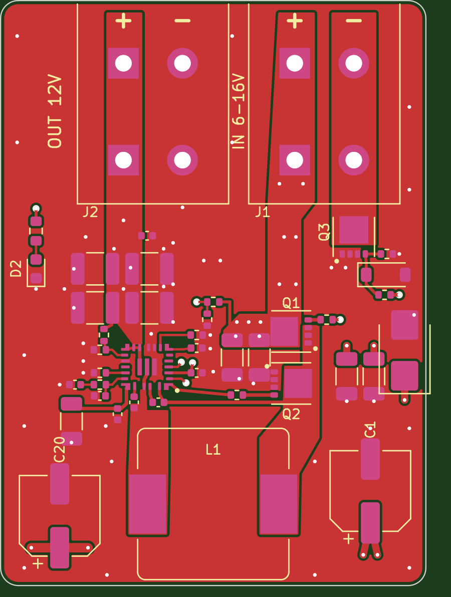

# FRC PoE-switch 12 V buck-boost

A small 4-layer board that takes FRC robot power (a PDH/PDP breaker slot) and
holds a steady **12.0 V** for a Linovision **POE-Switch0504GDF**
(4-port gigabit PoE, DC 9-57 V input). It keeps the switch and its PoE cameras or
coprocessors alive when the battery sags below 9 V under heavy drive load.



| | |
|---|---|
| Board | 36.0 x 49.5 mm, 4 layers, 1.6 mm, rounded corners |
| Input | 6-16 V (starts at ~5.9 V rising; 16 V TVS clamp), reverse-polarity protected |
| Output | 12.0 V, 5 A continuous (60 W). Below ~7 V input it is limited by the ~12.4 A inductor-current limit |
| Converter | TI **TPS552882** 4-switch buck-boost (standalone, no I2C), 400 kHz |
| Connectors | 2x **WAGO 2604-3102** lever terminals (5.0 mm, up to 12 AWG / 4 mm²). Wires enter from the top edge |
| Indicator | Green LED = 12 V output present |

Silkscreen, left to right along the top edge: **OUT 12V (+ -)** then **IN (+ -)**.

## Wiring on the robot

* **IN**: from a PDH/PDP channel through a **10-20 A breaker**, 14-16 AWG.
* **OUT**: to the switch's PWR1 terminal (9-57 V). The switch's PoE budget is 60 W at
  12 V input (Linovision datasheet), so keep total PoE load plus the switch's own draw under about 55 W.
* The output's `-` is the board's ground, behind the reverse-polarity FET. Don't tie it to the
  input `-` anywhere else.

## Ordering (JLCPCB PCB + assembly)

1. **PCB**: upload `fab/gerbers_JLCPCB.zip` with 4 layers, 1.6 mm, 1 oz outer / 0.5 oz inner.
   2 oz outer copper is a worthwhile upgrade if you plan to run near 60 W.
2. **Assembly**: top side only. Upload `fab/BOM_JLCPCB.csv` and `fab/CPL_JLCPCB.csv`.
   * MPNs are given for every part. Only L1's LCSC number (C41422303) is filled in, so let JLC
     match the rest by MPN or value and footprint.
   * **Check part rotations in JLC's placement preview**, especially U1 (pin 1 dot),
     Q1-Q3, D1, D3, D2, C1 and C20. JLC's library orientations sometimes differ from KiCad's.
3. **Hand-solder** J1 and J2 (WAGO 2604-3102, `fab/BOM_hand_solder.csv`) after the board
   arrives. The pads are 2.6 mm with 1.4 mm drills, two pins per pole, and are connected solid to
   the copper planes, so use a big iron tip.

## First power-up

1. Bench supply at 12 V with a 0.5 A current limit and no load. Expect 12.0 V (±2 %) and the LED on.
2. Sweep the input from 6 V to 16 V with a 1-2 A load and check the output stays at 12 V.
3. Raise the load step by step to 5 A at 12 V input, then at 7 V input. Watch the temperatures of
   L1, Q1 and Q2 (the buck-leg FETs) and U1.
4. Reverse the input briefly at a low current limit and confirm nothing conducts.

## What's in here

```
frc-poe-buckboost.kicad_pro / .kicad_sch / .kicad_pcb   KiCad 7 project
frc_poe.pretty/      TPS552882 VQFN-HR-26, WAGO 2604-3102, NexFET SON3x3 footprints
fab/                 Gerbers + drill (zip), JLC BOM, JLC CPL, hand-solder BOM
docs/                schematic.pdf, board_top.png, board_layers.png
scripts/             generators - design.py is the single source of truth
```

Regenerate everything after editing `scripts/design.py` (needs KiCad 7 and its
`pcbnew` Python module):

```bash
python3 scripts/gen_footprints.py
python3 scripts/gen_sch.py
/usr/bin/python3 scripts/gen_pcb.py
/usr/bin/python3 scripts/fill_drc.py
/usr/bin/python3 scripts/gen_fab.py
```

## Design notes

* **Layers**: top = parts, switch-node and power pours. Inner 1 = solid GND. Inner 2 = VOUT
  plane (left) and VIN plane (right). Bottom = GND plus the DR1H and EN traces.
* **Reverse polarity**: Q3 (low-side N-FET, gate from VIN through R12, 12 V zener clamp D3).
* **Values** (FB 102k/11.3k, FSW 49.9k, ILIM 26.7k, compensation 15k + 10 nF + 100 pF, VCC 22 µF,
  6.8 µH inductor, external CSD17577Q3A buck FETs) follow two published TPS552882/TPS55288
  designs: a 12 V output stage in EwoudVV/ducktop2 and a 16 A booster in
  mikegoelzer/Homebrew-ECP5-SBC. The output bulk (100 µF hybrid + 4x 22 µF) is at least what
  the 12 V reference uses, which keeps the boost-mode right-half-plane zero well above crossover.
* **Checks done**: the schematic netlist, the PCB pad nets and `design.py` all match. KiCad DRC
  reports 0 unconnected items and 0 clearance errors. What's left is courtyard overlap between
  deliberately tight parts (hot-loop caps next to the FETs, boot cap next to U1) and silkscreen
  clipping.
* **Not yet verified**: there is no simulation and no built prototype. I couldn't reach TI's
  datasheet from the design environment, so the U1 pinout and land pattern come from two
  independent published footprints that agree with each other. Check both against the
  TPS552882 datasheet before ordering.
