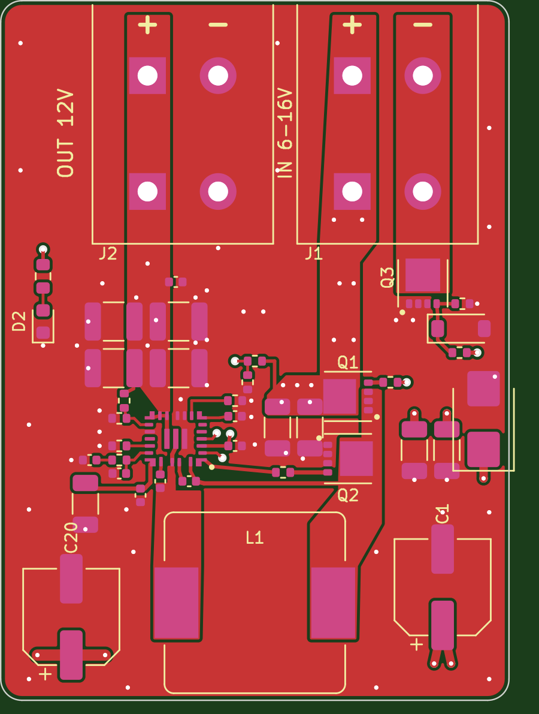

# Turner Vision PoE Buck-Boost: features and specs

A small custom power board that keeps the robot's PoE network switch (and the cameras and
coprocessors it powers) running at a steady 12 V while the battery sags under heavy drive load.

## What it does

The robot battery swings from about 13 V down to 7 V or lower under hard driving. The PoE switch
(Linovision POE-Switch0504GDF) needs at least 9 V, so a sagging battery could reboot the switch and
drop every camera and coprocessor on it mid-match. This board is a **buck-boost converter**: it
steps the voltage down when the battery is high and up when it is low, and holds the output at
**12.1 V** for any input from about 5 V to 16 V.

## Specifications

| | |
|---|---|
| Input voltage | 6-16 V operating. Turns on at about 5.5 V rising, turns off at about 5.0 V falling |
| Output voltage | 12.1 V (±2 %) |
| Output current | 5 A continuous (60 W) |
| Full output power | Down to about 5.3 V input |
| Input current | About 5.4 A at 12 V in and 11 A at 6 V in, at 60 W out. Limited by the converter to about 15 A (12.7-17.2 A) |
| Input fuse | **20 A breaker** on a PDH/PDP channel (marked on the case) |
| Wire | 14-16 AWG in and out |
| Converter | Texas Instruments TPS552882 buck-boost controller, 400 kHz with spread-spectrum dithering |
| Connectors | 2x WAGO 2604-3102 lever terminals (tool-free, up to 12 AWG) |
| Indicator | Green LED: 12 V output present |
| Board | 36 x 57 mm, 4-layer, 1.6 mm, assembled by JLCPCB |
| Case | 3D-printed PETG, 43 x 64 x 23 mm (1.69 x 2.52 x 0.89 in); 78.5 mm (3.09 in) across the mounting ears |
| Mounting | 4x #10 bolts, 2.500 x 1.890 in pattern (or zip ties through the floor) |

## Protection features

* **Reverse polarity**: a MOSFET in the negative input lead conducts only when the input is wired
  the right way round. Wired backwards, nothing flows.
* **Overvoltage spikes**: a 16 V TVS diode clamps transients from motors and breaker trips.
* **Current limit**: the converter limits its own (inductor) current to about 15 A, below the
  20 A breaker, so overloads are limited by the board before the breaker.
* **Output overvoltage protection**: built into the TI controller.
* **Undervoltage lockout**: below about 5 V in it shuts off cleanly instead of running with a
  collapsing output, and it restarts on its own once the input recovers (about 0.5 V of
  hysteresis, so it doesn't flicker at the threshold).
* **Thermal shutdown**: built into the TI controller.

## FRC robot electrical notes

For inspectors. Check against the current season's game manual; this is how the board is designed
to meet the usual custom-circuit requirements.

* **Powered from the PDH/PDP** through a single **20 A** breaker channel, with 14-16 AWG wire
  (heavier than the minimum usually required for a 20 A circuit).
* **Isolated from the frame**:
  * The board's three mounting holes are non-plated and have no copper within 3.3 mm of them.
  * The board sits on plastic standoffs inside a plastic case, and no metal standoffs are used.
  * The case bolts to the robot through its own plastic ears.
* **Powers only the network switch.** It doesn't power the roboRIO, the radio or any motor
  controller, and it doesn't connect to the CAN bus.
* **Output ground**: the output's − is the board's ground, behind the reverse-polarity FET. It is
  not tied to the input − anywhere else.
* **Fully enclosed**: only the terminal levers and the wire entries are exposed, at the top of the
  case. Polarity and voltages are labeled on the lid, next to each terminal.

## Status

* First board assembled and bench tested (Nov 2026):
  * Output comes on and holds 12 V.
  * Runs the PoE switch with a Raspberry Pi and an Orange Pi, stable with the bench supply
    set to 6.7 V. The board stays cool.
  * Undervoltage lockout confirmed on a scope: the output shuts off cleanly at 5.0 V in and
    soft-starts on its own when the input recovers.
* Still to test:
  * Full 5 A (60 W) load across the 6-16 V input range.
  * Efficiency.
  * Temperatures in the closed case.

## More detail

* [`README.md`](../README.md): wiring, ordering, first power-up, what each part does, design notes
* [`schematic.pdf`](schematic.pdf), [`enclosure/README.md`](../enclosure/README.md) (case, mounting, lid sticker)
* [`case_dimensions.png`](case_dimensions.png): case drawing in inches
