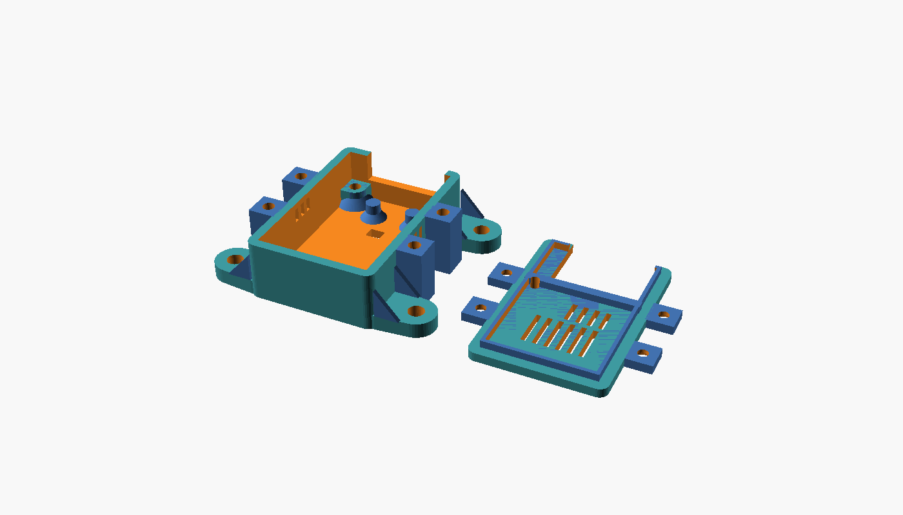
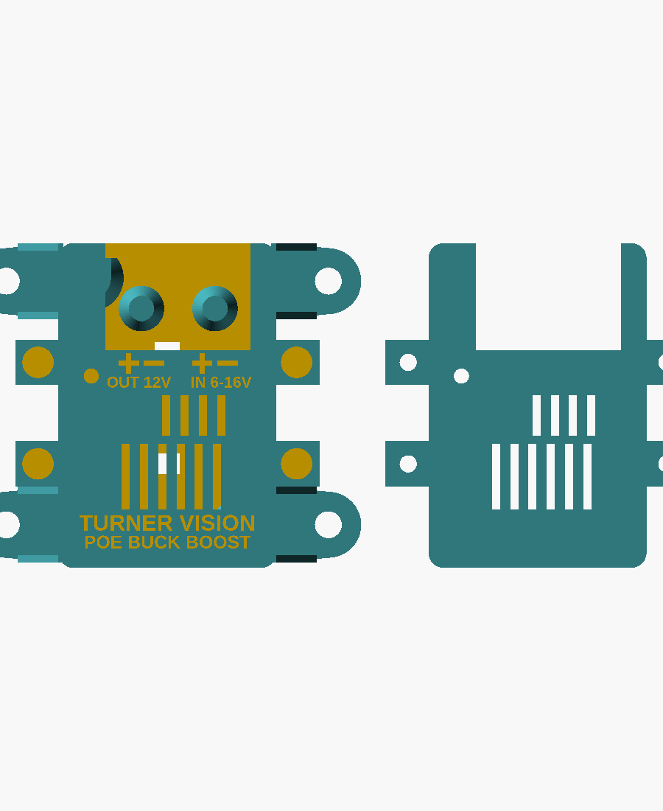

# Case for the FRC PoE 12 V board

A tough two-piece PETG case for the 36 x 57 mm board (with mounting holes). The board screws down
onto three beefy standoffs in the tray, and the lid is held on with four M3 screws.

| | |
|---|---|
| Outside (tray + lid) | 43 x 64 x 22.6 mm; 76.5 mm wide across the mounting ears |
| Walls / floor / lid | 3.0 / 3.0 / 3.0 mm, 3 mm corner radius |
| Board mounting | 3 standoffs under the board's M3 holes: 8 mm across at the top, flared to 13 mm at the floor, fused into the case walls. M3 heat-set insert in each; the board screws down from the top |
| Terminal support | 2 pillars under the WAGO terminals, 0.15 mm below the board. Pushing a lever or a wire presses the board onto them instead of bending it |
| Robot mounting | 4 ears with gussets, one at each end on each side. #10 clearance holes (5.3 mm), **2.5" apart** across the case (FRC ½" hole grid). Two zip-tie slots in the floor as a backup |
| Lid fixing | 4x M3 x 10 screws (counterbored) into M3 heat-set inserts in the side bosses |
| Lid label | Engraved 0.6 mm: **+ / −** over each terminal pole, `OUT 12V` and `IN 6-16V`, and `TURNER VISION / POE BUCK BOOST`. Prints face-down, so it comes out on the first layer; fill with paint, or change filament color at 0.6 mm |
| Openings | Lid open above both WAGO terminals: the wires enter the terminals **vertically** from the top, and the levers swing out over the open front wall. LED window, vents over the FETs and inductor, side vents |

## Files

* `case_tray.stl`, `case_lid.stl`: ready for PrusaSlicer. The lid is already flipped flat-side down.
* `case.scad`: the parametric OpenSCAD source. Board size, hole positions, standoff size, wall
  thickness, clearances, ear spacing and the insert hole size are all variables at the top. Export
  one part with `openscad -D 'part="tray"' -o case_tray.stl case.scad`.

## Printing on the Prusa MK4

* **Material**: PETG is the tough, easy choice. For more impact and heat resistance, use Prusament
  PC Blend or ASA, but those want an enclosure to avoid warping.
* 0.4 mm nozzle, 0.2 mm layers, **6 perimeters**, 5 top / 5 bottom layers, **40 % gyroid** infill.
  Six perimeters make the standoffs and bosses solid plastic around the inserts.
* No supports. Print the tray floor-down and the lid as exported (outer face on the sheet).
* Both parts fit on the sheet together.

## Hardware

* 7x M3 heat-set inserts (M3 x 5.7 mm, for a 4.0 mm hole): 3 in the standoffs, 4 in the lid
  bosses. Press them in with a soldering iron; keep the standoff inserts flush or just below the top.
* 3x M3 x 8 screws (socket or pan head, **no metal washers**) to hold the board. The heads (5.5 mm)
  sit inside the board's 6.6 mm copper-free ring, so the screws touch no circuit. Nylon washers are fine.
* 4x M3 x 10 socket-head screws for the lid.
* 4x #10-32 bolts + nylock nuts to mount to the robot (or zip ties through the floor slots).
* No inserts? Set `insert_d = 2.6` in `case.scad` and use M3 self-tapping screws instead.

## Assembly

1. Solder the WAGO terminals onto the board first.
2. Lay the board on the standoffs with the terminals toward the open front. Screw it down with the
   three M3 x 8 screws. Snug, not tight: PETG creeps.
3. Fit the lid. Its lip drops inside the walls. Screw it down, then mount the case to the robot.
4. Strip the wires, lift the levers through the lid opening, insert the wires straight down and close
   the levers.

## Notes

* Covered parts get 9 mm of headroom; the tallest are the 7.7 mm bulk capacitors.
* The terminal bodies (18.4 mm tall, 21.3 mm to the lever tops) stick up through the lid opening.
* The plastic standoffs and pillars touch only the board's soldermask, so the board stays isolated
  from the robot frame (FRC rule). Don't swap in metal standoffs.
