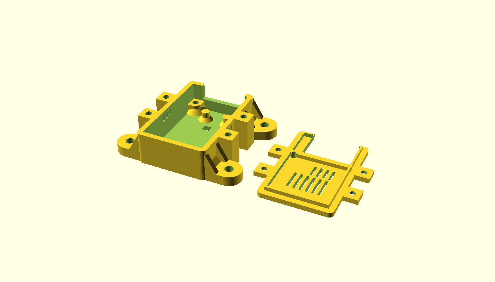
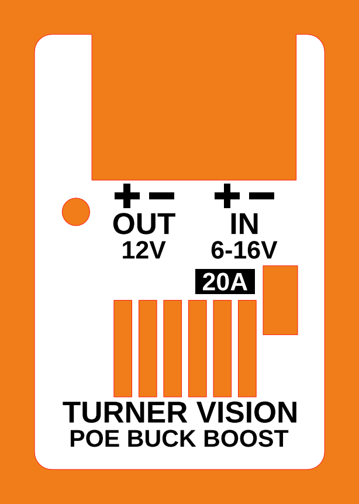
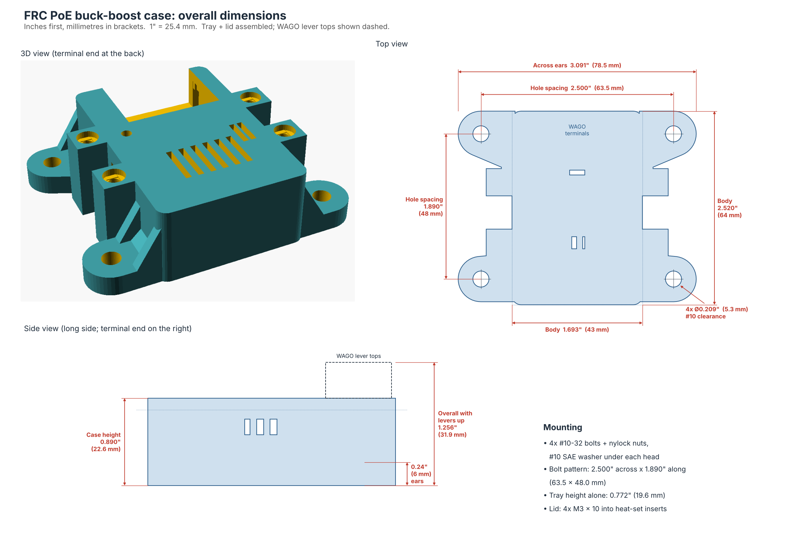
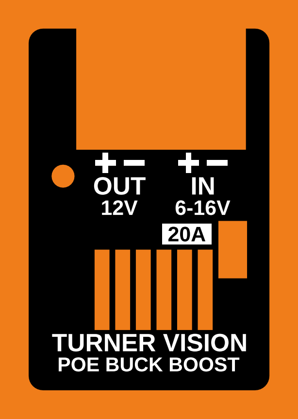

# Case for the FRC PoE 12 V board

A tough two-piece PETG case for the 36 x 57 mm board (with mounting holes). The board screws down
onto three beefy standoffs in the tray, and the lid is held on with four M3 screws.

| | |
|---|---|
| Outside (tray + lid) | 43 x 64 x 22.6 mm; 78.5 mm wide across the mounting ears |
| Walls / floor / lid | 3.0 / 3.0 / 3.0 mm, 3 mm corner radius |
| Board mounting | 3 standoffs under the board's M3 holes: 8 mm across at the top, flared to 13 mm at the floor, fused into the case walls. M3 heat-set insert in each; the board screws down from the top |
| Terminal support | 2 pillars under the WAGO terminals, 0.15 mm below the board. Pushing a lever or a wire presses the board onto them instead of bending it |
| Robot mounting | 4 ears, 6 mm thick and 15 mm wide out to the hole, one at each end on each side. Each ear is fused to the wall all the way from the case end to the next lid-screw boss, with a 3 mm root fillet and two 3 mm gussets 12 mm up the wall. #10 clearance holes (5.3 mm), **2.500" (63.5 mm) apart across the case and 1.890" (48 mm) along it**; a #10 SAE washer (11.1 mm) fits under the bolt head without touching the gussets. Two zip-tie slots in the floor as a backup |
| Lid fixing | 4x M3 x 10 screws (counterbored) into M3 heat-set inserts in the side bosses |
| Lid label | Flat top with a full-size print-and-cut sticker: **+ / −** over each terminal pole, **OUT / 12V** and **IN / 6-16V / 20A** over the terminals, and `TURNER VISION / POE BUCK BOOST`. See *Lid sticker* below |
| Openings | Lid open above both WAGO terminals: the wires enter the terminals **vertically** from the top, and the levers swing out over the open front wall. LED window, vents over the inductor and beside the FETs, side vents |

## Files

* `case_tray.stl`, `case_lid.stl`: ready for PrusaSlicer. The lid is already flipped flat-side down.
* `case.scad`: the parametric OpenSCAD source. Board size, hole positions, standoff size, wall
  thickness, clearances, ear spacing and the insert hole size are all variables at the top. Export
  one part with `openscad -D 'part="tray"' -o case_tray.stl case.scad`.

## Printing on the Prusa MK4

* **Material**: PETG is the tough, easy choice. For more impact and heat resistance, use Prusament
  PC Blend or ASA, but those want an enclosure to avoid warping.
* 0.4 mm nozzle, 0.2 mm layers, **6 perimeters**, 5 top / 5 bottom layers, **40 % gyroid** infill.
  Six perimeters make the standoffs and bosses solid plastic around the inserts.
* No supports. Print the tray floor-down and the lid as exported (outer face on the sheet).
* Both parts fit on the sheet together.

* The screw counterbores are on the lid's face, so they print first. The model has two 0.2 mm
  bridge layers above each one (a slot, then a square) so the plastic above them doesn't print over
  air. Don't drill them out: the round hole through them is already open.

## Lid sticker (print and cut)

 

The lid top is flat. Its markings are one 42 x 63 mm sticker with the terminal opening, LED window
and vents cut out:

* **+ / −** over each terminal pole
* **OUT / 12V** over the output and **IN / 6-16V** over the input
* **20A** in a black box, the breaker size to match
* `TURNER VISION / POE BUCK BOOST`

| File (in `docs/`) | Use |
|---|---|
| `lid_sticker.svg` / `.pdf` | Black artwork with no background, plus cut lines (red), aligned, 1:1 in mm. For white or clear vinyl. The SVG needs Silhouette Studio Designer Edition or later |
| `lid_sticker_black.svg` / `.pdf` | White artwork on a black background, plus the same cut lines. Print on white vinyl. The black runs 1 mm past every cut line (bleed), so a slightly off cut leaves no white edge |
| `lid_sticker_cut.dxf` | Cut lines only, for Silhouette Studio Basic |

1. In Silhouette Studio, open `lid_sticker.svg` (or `lid_sticker_black.svg`) and check that it is **42 x 63 mm**. Turn on
   registration marks (Print & Cut) and place the sticker inside them.
2. Ungroup it, select the red outlines and set their **line color to none** so they don't print. They
   still cut. Set the cut to **cut by line/selection** for those paths only.
3. Print on **white vinyl** for black on white, or on **clear vinyl** so the orange case shows
   through. The black version needs white vinyl, and its large black area takes longer to dry with
   inkjet ink, so leave it before laminating or cutting. Laser or pigment ink lasts best. A clear laminate on top protects it on a robot.
4. Cut, weed the opening, the LED window and the vent slots, and apply.

The sticker is inset 0.5 mm from the lid edges and every hole is 0.5 mm bigger than the lid's, so
small placement errors don't cover a vent. Line up the terminal opening first.

The cut outline comes straight from the lid model. If you change the lid, run
`python3 scripts/gen_lid_sticker.py` (it needs OpenSCAD and matplotlib) to regenerate all three
files. To engrave the markings in the plastic instead, set `lid_engrave = true` in `case.scad`
(0.6 mm deep; text of 3 mm or more for a 0.4 mm nozzle).

## Hardware

* 7x M3 heat-set inserts (M3 x 5.7 mm, for a 4.0 mm hole): 3 in the standoffs, 4 in the lid
  bosses. Press them in with a soldering iron; keep the standoff inserts flush or just below the top.
* 3x M3 x 8 screws (socket or pan head, **no metal washers**) to hold the board. The heads (5.5 mm)
  sit inside the board's 6.6 mm copper-free ring, so the screws touch no circuit. Nylon washers are fine.
* 4x M3 x 10 socket-head screws for the lid.
* 4x #10-32 bolts + nylock nuts to mount to the robot (or zip ties through the floor slots). Put a #10 SAE washer
  under each bolt head to spread the load on the plastic.
* No inserts? Set `insert_d = 2.6` in `case.scad` and use M3 self-tapping screws instead.

## Assembly

1. Solder the WAGO terminals onto the board first.
2. Lay the board on the standoffs with the terminals toward the open front. Screw it down with the
   three M3 x 8 screws. Snug, not tight: PETG creeps.
3. Fit the lid. Its lip drops inside the walls. Screw it down, then mount the case to the robot.
4. Strip the wires, lift the levers through the lid opening, insert the wires straight down and close
   the levers.

## Notes

* Covered parts get 9 mm of headroom; the tallest are the 7.7 mm bulk capacitors.
* The terminal bodies (18.4 mm tall, 21.3 mm to the lever tops) stick up through the lid opening.
* The plastic standoffs and pillars touch only the board's soldermask, so the board stays isolated
  from the robot frame (FRC rule). Don't swap in metal standoffs.
